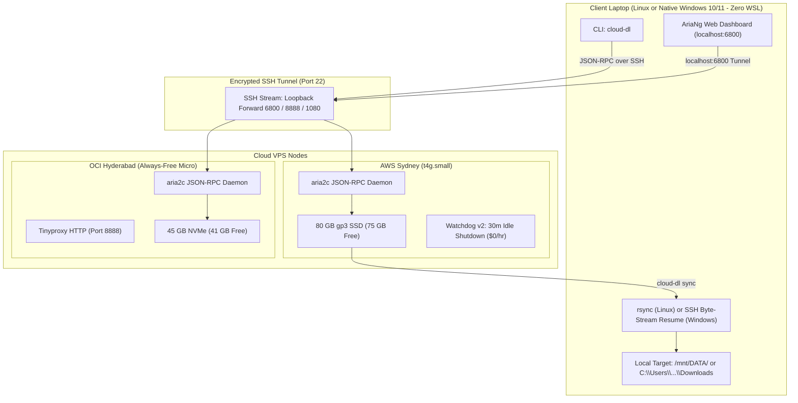
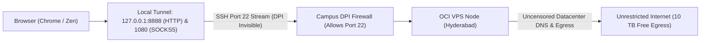

# cloud-dl: Personal Multi-Cloud Download Engine & Network Bypass Toolkit

[-blue.svg)](https://github.com/Anurup-R-Krishnan/cloud-dl)
[](https://www.python.org/)
[](https://aws.amazon.com/)
[](https://aria2.github.io/)
[](#security--architecture)
[](.github/workflows/ci.yml)

cloud-dl is a personal multi-cloud downloading engine, uncensored general browsing suite, and campus network bypass toolkit. It allows you to download torrents, magnet links, and large direct files into high-speed cloud VPS nodes (bursting up to 5 Gbps on AWS or 10 TB free egress on Oracle Cloud), monitor progress via CLI or browser Web UI, sync completed files directly to your external hard drive with resume capability, and browse the web without campus firewall restrictions or DNS leaks.

---

## Table of Contents

- [Architectural Overview](#architectural-overview)
- [Key Capabilities](#key-capabilities)
- [Quick Start & Installation](#quick-start--installation)
- [CLI Reference: `cloud-dl`](#cli-reference-cloud-dl)
- [General Browsing Suite: `cloud-dl browse`](#general-browsing-suite-cloud-dl-browse)
- [Intelligent Watchdog v2 (Auto-Shutdown)](#intelligent-watchdog-v2-auto-shutdown)
- [Hardware & Storage Recovery (1TB HDD Fix)](#hardware--storage-recovery-1tb-hdd-fix)
- [Test Suites & Verification](#test-suites--verification)
- [Repository Layout](#repository-layout)
- [License & Security Notice](#license--security-notice)

---

## Architectural Overview

### 1. Cloud Download Engine Flow



### 2. General Browsing & Campus DPI Evasion Flow



---

## Key Capabilities

### 1. Dual-Cloud Routing with Disk Capacity Guard
- **AWS Sydney (`t4g.small`)**: Powered by AWS Graviton2 Arm64, bursting up to 5 Gbps network bandwidth with an 80 GB SSD volume. Configured with a 30-minute idle watchdog to freeze EC2 billing to $0.00/hour when idle, covered by promotional cloud credits.
- **OCI Hyderabad (`VM.Standard.E2.1.Micro`)**: Always Free ($0 forever) with 10 TB free monthly egress and fast 1.8 ms local roundtrip latency.
- **Safety Disk Guard**: `cloud-dl add` checks available storage on both providers in real time and automatically warns before sending downloads that exceed OCI's 41 GB capacity.

### 2. Modern Interfaces: CLI + Web UI
- **Sub-4-Second Batch CLI**: Optimized single-trip JSON-RPC multicalls query active downloads, queue lengths, speeds, and remote disk capacity in under 4 seconds.
- **Live Terminal Monitor (`cloud-dl top`)**: Interactive real-time curses monitor displaying visual progress bars, peer/seeder counts, speeds, and ETA.
- **AriaNg Web Dashboard (`cloud-dl ui`)**: Single-file, zero-overhead browser UI running via loopback SSH tunnel on `localhost:6800`.

### 3. General Browsing (`cloud-dl browse`)
- **Zero WSL / Zero Extra Tools on Windows**: Automatically opens a SOCKS5 SSH tunnel (`127.0.0.1:1080`) using built-in Windows OpenSSH and launches Edge, Chrome, Zen, or Firefox in an isolated profile.
- **Zero DNS Leaks**: Enforces remote SOCKS5 hostname resolution (`MAP * ~NOTFOUND` in Chrome/Edge, `socks_remote_dns=true` in Firefox/Zen) so campus DNS filters never see your queries.
- **Isolated Profiles**: Keeps proxy sessions separated in `%LOCALAPPDATA%\cloud-dl\browser-<name>` (Windows) or `~/.cache/cloud-dl/browser-<name>` (Linux).

---

## Quick Start & Installation

### Option A: Windows 10 / 11 (Zero WSL, PowerShell Guide)

No WSL, Git Bash, or Ubuntu terminal required. Open **PowerShell** and run:

```powershell
# 1. Install Python 3.13, uv, and AWS CLI v2 (only needed once; OpenSSH is already built into Windows 10/11)
winget install Python.Python.3.13 astral-sh.uv Amazon.AWSCLI

# Restart PowerShell so PATH updates take effect, then install cloud-dl directly from GitHub:
uv tool install git+https://github.com/Anurup-R-Krishnan/cloud-dl.git

# 2. Place your SSH private key + config into C:\Users\<YourName>\.ssh\config
# (See configs/ssh_config_snippet.txt; uses built-in Windows ssh.exe)

# 3. Run first-time setup and diagnostics:
cloud-dl init
cloud-dl doctor

# 4. Everyday commands (all native in PowerShell):
cloud-dl browse edge              # Browse via OCI SOCKS5 proxy in an isolated Edge window
cloud-dl add "magnet:?xt=..."     # Queue download in the cloud
cloud-dl ui                       # Open AriaNg web dashboard in your default browser
cloud-dl sync "Package Name" --dest "D:\Downloads" --verify --stop-after
```

`cloud-dl sync` automatically selects the built-in resumable SSH byte-stream backend on Windows (resuming partial files at exact byte offsets if Wi-Fi drops, with zero `rsync` or WSL needed).

### Option B: Linux (Arch / Ubuntu / macOS)

```bash
# Clone the repository
git clone https://github.com/Anurup-R-Krishnan/cloud-dl.git ~/.local/share/cloud-dl-repo
cd ~/.local/share/cloud-dl-repo

# Install editable CLI package via uv
uv tool install --editable .

# Generate ~/.config/cloud-dl/config.json (0600 permissions, random 32-char RPC secret)
cloud-dl init
cloud-dl doctor
```

### 2. Configure SSH Aliases (`~/.ssh/config`)

See [`configs/ssh_config_snippet.txt`](configs/ssh_config_snippet.txt):

```sshconfig
Host aws-vps
  HostName <AWS_DYNAMIC_IP>
  User ubuntu
  IdentityFile ~/.ssh/oci_vps
  ServerAliveInterval 15
  ServerAliveCountMax 8
  Ciphers aes128-gcm@openssh.com,chacha20-poly1305@openssh.com
  StrictHostKeyChecking accept-new

Host oci-vps
  HostName <OCI_PUBLIC_IP>
  User ubuntu
  IdentityFile ~/.ssh/oci_vps
  ServerAliveInterval 30
  ServerAliveCountMax 3
  StrictHostKeyChecking accept-new
```

### 3. Start the Background Proxy Service

```bash
# Enable the persistent systemd user tunnel
mkdir -p ~/.config/systemd/user
cat > ~/.config/systemd/user/oci-socks5.service << "EOF"
[Unit]
Description=OCI VPS Proxy Tunnel (SOCKS5 1080 & HTTP 8888)
After=network.target

[Service]
Type=simple
ExecStart=/usr/bin/ssh -N -D 1080 -L 8888:127.0.0.1:8888 -o ServerAliveInterval=30 -o ServerAliveCountMax=3 -o ExitOnForwardFailure=yes oci-vps
Restart=always
RestartSec=5s

[Install]
WantedBy=default.target
EOF

systemctl --user daemon-reload
systemctl --user enable --now oci-socks5.service
```

---

## CLI Reference: `cloud-dl`

```text
usage: cloud-dl [-h] {add,status,top,list,sync,clean,limit,extract,test,speed,cost,browse,ui,pause,resume,cancel,start,stop,watchdog} ...
```

### Commands & Practical Examples

| Subcommand | Arguments | Description & Example |
|---|---|---|
| `add` | `<url\|magnet\|.torrent>` | Adds a download to the queue. Auto-wakes AWS if offline.<br>`cloud-dl add "magnet:?xt=urn:btih:..."` |
| `add -f` | `-f <file.txt>` | Queues multiple URLs/magnets in batch from a text file.<br>`cloud-dl add -f queue.txt --cloud aws` |
| `status` | `[--cloud aws\|oci]` | Displays active downloads, ETA, speeds, and free disk space.<br>`cloud-dl status` |
| `top` | `[--cloud aws\|oci]` | Interactive auto-refreshing monitor (refreshes every 2s; Ctrl+C to exit).<br>`cloud-dl top` |
| `sync` | `[name] [--dest path]` | Syncs completed files using `rsync` (Linux) or resumable SSH byte-stream (Windows/no-WSL).<br>`cloud-dl sync "Package Name" --dest "/mnt/DATA" --verify --stop-after` |
| `limit` | `[--down 10M] [--up 1M]` | Inspects or adjusts global upload/download bandwidth limits.<br>`cloud-dl limit --down 8M --up 50K` |
| `extract` | `<archive>` | Remotely extracts `.zip`, `.tar.gz`, `.7z`, or `.rar` archives on the VPS.<br>`cloud-dl extract "release.7z"` |
| `test` | None | Benchmarks SSH latency and pipe responsiveness across both clouds.<br>`cloud-dl test` |
| `speed` | None | Benchmarks real-world network pipe bandwidth from both clouds.<br>`cloud-dl speed` |
| `cost` | None | Audits real-time AWS spending, burn rate, and credit balance.<br>`cloud-dl cost` |
| `clean` | `[name] [-y]` | Deletes downloaded files from the VPS to reclaim SSD space.<br>`cloud-dl clean "Heavy Repack" -y` |
| `ui` | `[--stop]` | Launches the browser Web UI over an SSH tunnel.<br>`cloud-dl ui` *(or `cloud-dl ui --stop`)* |
| `watchdog` | `[--cloud aws]` | Queries the 30-minute idle auto-shutdown timer on the VPS.<br>`cloud-dl watchdog` |
| `stop` | `[--cloud aws]` | Manually shuts down the EC2 instance to pause compute billing.<br>`cloud-dl stop --cloud aws` |

---

## General Browsing Suite: `cloud-dl browse`

`cloud-dl browse` works natively on Windows (PowerShell), macOS, and Linux without WSL or extra shell scripts:

```text
cloud-dl browse chrome [url]   # Launch isolated Chrome via OCI SOCKS5
cloud-dl browse edge [url]     # Launch isolated Microsoft Edge (built into Windows 10/11)
cloud-dl browse zen [url]      # Launch isolated Zen Browser
cloud-dl browse firefox [url]  # Launch isolated Firefox
cloud-dl browse status         # Check active SOCKS5/HTTP proxy ports
cloud-dl browse env            # Print PowerShell ($env:) or Bash (export) proxy variables
cloud-dl browse stop           # Close tracked SOCKS5 SSH tunnel
```

On Windows PowerShell:
```powershell
cloud-dl browse env | Invoke-Expression
```
On Bash / Zsh:
```bash
eval "$(cloud-dl browse env)"
```

---

## Intelligent Watchdog v2 (Auto-Shutdown)

To ensure that your AWS credits are never wasted on idle instances, Watchdog v2 runs every 2 minutes as a root cron job on the AWS VPS ([`scripts/auto-shutdown.sh`](scripts/auto-shutdown.sh)):

```bash
#!/bin/bash
# 1. Queries aria2 JSON-RPC for active or queued jobs:
ACTIVE=$(curl -s http://127.0.0.1:6800/jsonrpc ... "aria2.tellActive")
WAITING=$(curl -s http://127.0.0.1:6800/jsonrpc ... "aria2.tellWaiting")

# 2. Checks established SSH sessions:
SSH_SESSIONS=$(ss -tn state established '( sport = :22 )' | grep -v Recv-Q | wc -l)

# 3. If downloads == 0 and SSH == 0 for 30 consecutive minutes:
if [ "$DIFF" -ge 1800 ]; then
    logger "Auto-shutdown: System idle for 30 minutes. Shutting down."
    /sbin/shutdown -h now
fi
```
When stopped, EC2 compute billing freezes to $0.00/hour. Only the standard 80 GB `gp3` storage volume (~$6.40/month) is billed, covered by your credit balance.

---

## Hardware & Storage Recovery (1TB HDD Fix)

When using external mechanical drives over USB, faulty USB-to-SATA bridges (such as the JMicron JMS578 `152d:0578`) often deadlock the Linux kernel `uas` driver when encountering bad sectors (such as sector `67843`).

This repository includes the hardware quirk configuration ([`configs/disable-uas-jmicron.conf`](configs/disable-uas-jmicron.conf)):

```text
# Place in /etc/modprobe.d/disable-uas-jmicron.conf:
options usb-storage quirks=152d:0578:u
```

This forces the kernel to use the stable `usb-storage` Bulk-Only Transport driver instead of `uas`, allowing standard error recovery without offlining the drive or freezing I/O.

### Optimal `/etc/fstab` Mount Entry
```text
UUID=42F4-D6C9 /mnt/DATA exfat rw,noatime,uid=1000,gid=1000,fmask=0022,dmask=0022,iocharset=utf8,errors=continue 0 0
```

---

## Test Suites & Verification

Run offline unit tests, linting, and live integration validation:

```bash
# 1. Offline mocked unit & watchdog test suite:
pytest tests/ -v

# 2. Strict linter & formatting checks:
ruff check src/ tests/ regression_tests/ scripts/cloud-dl

# 3. Live CLI, Aria2 JSON-RPC, & Watchdog v2 probe (requires configured VPS hosts):
python3 regression_tests/regression_test_clouddl.py

# 4. System health check:
cloud-dl doctor
```

---

## Repository Layout

```text
cloud-dl/
├── README.md                              <- Master Documentation & Operational Guide
├── LICENSE                                <- MIT License
├── SECURITY.md                            <- Vulnerability disclosure & secret hygiene policy
├── CONTRIBUTING.md                        <- Development setup & PR guidelines
├── CHANGELOG.md                           <- Version release history
├── pyproject.toml                         <- Package metadata, ruff lint, & pytest config
├── .pre-commit-config.yaml                <- Pre-commit ruff, gitleaks, & hygiene hooks
├── .github/workflows/
│   ├── ci.yml                             <- Automated lint & multi-Python pytest CI
│   └── release.yml                        <- Tag-triggered wheel/sdist release & PyPI OIDC
├── docs/
│   ├── architecture.md                    <- Layer-by-layer packet journey & DPI mechanics
│   └── aws-vs-oci.md                      <- Cost analysis, bandwidth limits, and credit consumption
├── src/cloud_dl/
│   ├── __init__.py
│   ├── __main__.py                        <- `python -m cloud_dl` entrypoint
│   ├── aws.py                             <- EC2 start/stop lifecycle & auto `aws login`
│   ├── cli.py                             <- Argument parser, help formatter, top-level dispatch
│   ├── config.py                          <- Config loading, deep_merge, & `cloud-dl init`
│   ├── cost.py                            <- Billing analytics & bandwidth benchmarks
│   ├── doctor.py                          <- `cloud-dl doctor`, Watchdog probe, PID-tracked `ui`
│   ├── exceptions.py                      <- Domain exception hierarchy
│   ├── rpc.py                             <- Aria2 JSON-RPC client & live monitor
│   ├── ssh.py                             <- ControlMaster SSH transport & IP sync
│   └── sync.py                            <- exFAT-aware rsync sync, `--append`, `--verify`
├── tests/
│   ├── test_cloud_dl_offline.py           <- Offline mocked pytest unit suite
│   └── test_watchdog_scripts.py           <- Mocked PATH tests for Watchdog v2 shell script
├── scripts/
│   ├── oci-browse                         <- Uncensored General Browsing Launcher
│   ├── auto-shutdown.sh                   <- Watchdog v2 JSON-RPC auto-shutdown script
│   ├── user-data.sh                       <- Cloud-init VPS bootstrap script
│   └── aws-*                              <- Thin deprecated shims forwarding to cloud-dl
├── regression_tests/
│   └── regression_test_clouddl.py         <- Live Cloud-DL CLI & RPC validation
└── configs/
    ├── config.example.json                <- Sample `~/.config/cloud-dl/config.json` schema
    ├── ssh_config_snippet.txt             <- Sample SSH configuration
    ├── proxychains.conf                   <- SOCKS5 configuration for proxychains-ng
    └── disable-uas-jmicron.conf           <- Kernel quirk to prevent USB enclosure deadlocks
```

---

## License & Security

- **License**: Released under the [MIT License](LICENSE).
- **Security**: See [SECURITY.md](SECURITY.md). No private SSH keys, AWS credentials, or RPC tokens are tracked in this repository; runtime configuration is stored locally at `~/.config/cloud-dl/config.json` (`0600`).
- **Source**: `https://github.com/Anurup-R-Krishnan/cloud-dl`
